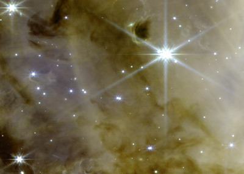
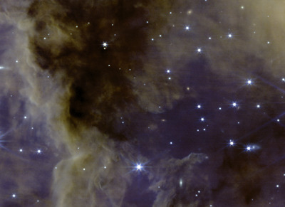
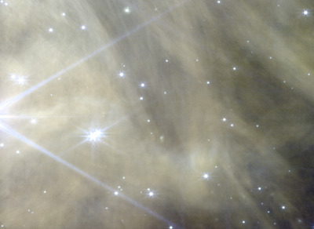
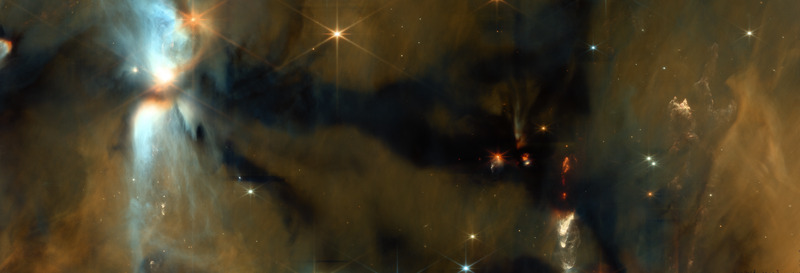
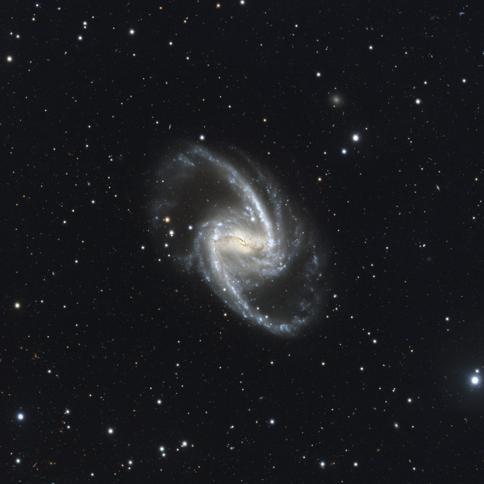

# Skyforge config gallery

Each section is an accepted result: preview, caption, config, tag and the command that reproduces the same file.
Generated by `skyforge gallery` from `configs/publish.yaml`, the accepted PNGs (`data/baselines/`) and the data headers;
not edited by hand. Русская версия: [GALLERY.ru.md](GALLERY.ru.md).

## NGC 3132 — JWST NIRCam, style measured


- **Program:** 2733, PI Klaus M. Pontoppidan; observed 2022-06-03; data public since 2022-07-13
- **Filters:** F090W 0.900 µm — blue (#0000ff); F187N 1.87 µm — cyan (#00ffff); F212N 2.12 µm — green (#00ff00); F356W 3.56 µm — yellow (#ffff00); F405N 4.05 µm — red (#ff0000); F470N 4.70 µm — red (#ff0000)
- **Credit:** NASA, ESA, CSA, STScI; processing: Denis Krivosheev; license of the processing CC BY-SA 4.0
- **Config:** [configs/ngc3132/measured.yaml](../configs/ngc3132/measured.yaml), tag [`phase-3k`](https://github.com/kriden187-cloud/skyforge/tree/phase-3k), accepted 2026-10-20
- **Final pixel hash (sha256):** `0f556d7667dbccca8ca49a82923d9bc79af94471caa7576f2c1fc1a49356f3b2`
- **What is shown:** Six NIRCam filters in wavelength order, F212N weight 0.25 (the H₂ halo is real).
- **Limitations:** Background steps along exposure-count boundaries up to ~0.6σ; cores of three saturated stars are white; bright-star spikes are outside the star mask.
- **Note:** Program ERO 2733 (Early Release Observations); official NIRCam image released 12 July 2022 (STScI 2022-033b, ESA/Webb weic2207b, “Southern Ring Nebula (NIRCam Image)”).
- **How to get the same file:**

  ```
  git checkout phase-3k
  skyforge run ngc3132 -s measured --bin 1        # downloads from MAST if the data is not on disk
  skyforge publish ngc3132 -s measured
  ```

## NGC 3132 — JWST NIRCam, style showcase


- **Program:** 2733, PI Klaus M. Pontoppidan; observed 2022-06-03; data public since 2022-07-13
- **Filters:** F090W 0.900 µm — blue (#0000ff); F187N 1.87 µm — cyan (#00ffff); F212N 2.12 µm — green (#00ff00); F356W 3.56 µm — orange (#ff9a20); F405N 4.05 µm — red (#ff0000); F470N 4.70 µm — red (#ff0000)
- **Credit:** NASA, ESA, CSA, STScI; processing: Denis Krivosheev; license of the processing CC BY-SA 4.0
- **Config:** [configs/ngc3132/showcase.yaml](../configs/ngc3132/showcase.yaml), tag [`phase-3k`](https://github.com/kriden187-cloud/skyforge/tree/phase-3k), accepted 2026-10-20
- **Final pixel hash (sha256):** `2e72fc9c06d71b12f33fc5eea9fc9f8dc03233b59476679ead8d7236e87c053f`
- **What is shown:** Showcase in the spirit of the NASA release: sky pedestal and toe, sky polynomial tapered towards the nebula, shadows 2, saturation 1.2.
- **Limitations:** Steps along exposure-count boundaries; three background details visible at ×2–×5; outer halo fainter than NASA's; one field star with a greenish core.
- **Note:** Program ERO 2733 (Early Release Observations); official NIRCam image released 12 July 2022 (STScI 2022-033b, ESA/Webb weic2207b, “Southern Ring Nebula (NIRCam Image)”).
- **Published:** [Flickr](https://www.flickr.com/photos/205062605@N07/55603640956/) (2026-10-21); [Wikimedia Commons](https://commons.wikimedia.org/wiki/File:NGC_3132_JWST_NIRCam_(Krivosheev).png) (2026-10-21)
- **How to get the same file:**

  ```
  git checkout phase-3k
  skyforge run ngc3132 -s showcase --bin 1        # downloads from MAST if the data is not on disk
  skyforge publish ngc3132 -s showcase
  ```

## NGC 3132 — HST WFPC2, style showcase


- **Program:** 6221, PI John Trauger; observed 1995-12-07; data public since 1996-12-08
- **Filters:** F502N 0.502 µm — blue (#0000ff); F656N 0.656 µm — green (#00ff00); F658N 0.658 µm — red (#ff0000)
- **Credit:** NASA, ESA, STScI; processing: Denis Krivosheev; license of the processing CC BY-SA 4.0
- **Config:** [configs/ngc3132hst/showcase.yaml](../configs/ngc3132hst/showcase.yaml), tag [`phase-3b`](https://github.com/kriden187-cloud/skyforge/tree/phase-3b), accepted 2026-10-20
- **Final pixel hash (sha256):** `827ebc2ecbb4149c77133c62679fc60f6f51640d3d2376147645e0e2afa82b26`
- **What is shown:** WFPC2 data from 1995, three narrow-band filters ([O III], Hα, [N II]), final at bin 2.
- **Limitations:** Bin 2 (bin 1 is drizzle oversampling); 65 cosmic-ray traces on the sky; 0.25% zeros in the blue sky channel; seams ≤ 6 px filled linearly, corners at sky level.
- **Note:** The same WFPC2 data underlie the 1998 Hubble Heritage image (STScI-1998-39).
- **How to get the same file:**

  ```
  git checkout phase-3b
  skyforge run ngc3132hst -s showcase --bin 2        # downloads from MAST if the data is not on disk
  skyforge publish ngc3132hst -s showcase
  ```

## Sh 2-305 — JWST NIRCam, style showcase


- **Program:** 4547, PI Mark J. McCaughrean; observed 2025-03-31; data public since 2026-04-02
- **Filters:** F182M 1.82 µm — blue (#3050ff); F300M 3.00 µm — light blue (#40c0ff); F335M 3.35 µm — yellow-green (#c0ff40); F360M 3.60 µm — orange (#ff9020); F444W 4.44 µm — red (#ff2020)
- **Credit:** NASA, ESA, CSA, STScI; processing: Denis Krivosheev; license of the processing CC BY-SA 4.0
- **Config:** [configs/sh2305/showcase.yaml](../configs/sh2305/showcase.yaml), tag [`phase-4`](https://github.com/kriden187-cloud/skyforge/tree/phase-4), accepted 2026-10-21
- **Final pixel hash (sha256):** `439762383405fb558353f75843485ff6bc04ae64279ee0b53e3e390ba270fe50`
- **What is shown:** Five NIRCam filters (F182M and four long-wavelength), wavelength-ordered palette with a warm shift, sky reference from the darkest blocks, sky level 16.
- **Limitations:** F182M 1/f stripes visible at ×5; the bright star's core is saturated; F212N not included (1/f stripes at level 3); PAH filaments are nearly one hue — texture is in brightness.
- **Note:** Data public since 2026-04-02. Known earlier processings of these data: Melina Thévenot (Wikimedia Commons, 2026-04-03); Thomas Carpentier (Flickr, 2026-04-03); Israel Velázquez Rodríguez (Flickr, 2026-04-03); Andrea Luck (Flickr, 2026-04-11); Mark McCaughrean, program PI (Flickr, 2026-04-15, copy on Wikimedia Commons); Mehmet Hakan Özsaraç (Flickr, 2026-05-18); Picturavis (Pixelfed, around 2026-05-22).
- **Published:** [Flickr](https://www.flickr.com/photos/205062605@N07/55603618036/) (2026-10-21); [Wikimedia Commons](https://commons.wikimedia.org/wiki/File:Star-forming_region_Sharpless_305_(Sh_2-305)_imaged_by_JWST_NIRCam_in_five_filters;_own_processing_of_public_MAST_data,_program_4547.png) (2026-10-21)
- **How to get the same file:**

  ```
  git checkout phase-4
  skyforge run sh2305 -s showcase --bin 1        # downloads from MAST if the data is not on disk
  skyforge publish sh2305 -s showcase
  ```

## W3 — JWST NIRCam, style showcase


Published on the platforms as separate images — left half of field W3-JWST-2 — NIRCam module A · right half of field W3-JWST-2 — NIRCam module B · fragment of field W3-JWST-2 (about 50×36″) between NIRCam detector gaps, module A — bright star and dust lanes · fragment of field W3-JWST-2 (about 50×36″) between NIRCam detector gaps, module A — dark dust cloud · fragment of field W3-JWST-2 (about 50×36″) between NIRCam detector gaps, module B — bright cloud:

    

- **Program:** 5437, PI William Best; observed 2024-10-29; data public since 2025-10-30
- **Filters:** F140M 1.40 µm — violet-blue (#6030ff); F182M 1.82 µm — blue (#3050ff); F210M 2.10 µm — light blue (#40c0ff); F300M 3.00 µm — cyan (#30ffb0); F335M 3.35 µm — yellow-green (#c0ff40); F360M 3.60 µm — yellow (#ffd820); F405N 4.05 µm — orange (#ff9020); F444W 4.44 µm — red (#ff2020)
- **Credit:** NASA, ESA, CSA, STScI; processing: Denis Krivosheev; license of the processing CC BY-SA 4.0
- **Config:** [configs/w3_2/showcase.yaml](../configs/w3_2/showcase.yaml), tag [`phase-6`](https://github.com/kriden187-cloud/skyforge/tree/phase-6), accepted 2026-10-22
- **Final pixel hash (sha256):** `6cfce60e995bc5fbef7e12c89d1e8c194c360cd3f1aa65e7d9c996e7007d8a11`
- **What is shown:** Eight NIRCam filters (F140M, F182M, F210M and five long-wavelength), both detector modules with the real gap between them; wavelength-ordered palette with a warm shift; white point on the nebula without stars in each filter; sky reference from the darkest blocks; short-wave detector gaps filled from the neighbouring short-wave filter.
- **Limitations:** Short-wave detector gaps (about 3.5″, 13% of a module) are filled by substituting the neighbouring filter — grain is visible at normal viewing; the program's dither is about 1″ against a 3.5″ gap, so a rebuild from the individual exposures (level 2) does not close the gaps; gap-free frames are published separately as fragments A2, A4, B3. About a dozen 4″ squares where gaps cross (0.2% of the area) are filled from F300M and differ in tone; dotted seams along the strip edges come from the source i2d. No empty sky in the field: the reference is the faintest nebula, sky at 18 instead of 16, the absolute level is nominal; short-wave 1/f stripes visible on the sky at 5×.
- **Note:** Field W3-JWST-2 of program 5437 (frame centre RA 36.80°, Dec +62.00°), in the W3 complex between IC 1795 and W3(OH). Data public since 2025-10-30. No earlier public colour processing of this field was found (search of 2026-10-21: web, Wikimedia Commons, Flickr; Reddit, AstroBin and X not checked). The neighbouring field W3-JWST-1A of the same program was processed by Thomas Carpentier (Flickr, 2025-10-13).
- **Published:** [Wikimedia Commons, A](https://commons.wikimedia.org/wiki/File:W3_Westerhout_3_JWST_NIRCam_module_A_dust_lanes_(Krivosheev).png) (2026-10-22); [Wikimedia Commons, B](https://commons.wikimedia.org/wiki/File:W3_Westerhout_3_JWST_NIRCam_module_B_bright_cloud_(Krivosheev).png) (2026-10-22); [Flickr, A](https://www.flickr.com/photos/205062605@N07/55605113763/) (2026-10-22); [Flickr, B](https://www.flickr.com/photos/205062605@N07/55605398725/) (2026-10-22)
- **How to get the same file:**

  ```
  git checkout phase-6
  skyforge run w3_2 -s showcase --bin 1        # downloads from MAST if the data is not on disk
  skyforge publish w3_2 -s showcase
  ```

## OMC3-N — JWST NIRCam, style showcase



- **Program:** 7433, PI Mika Juvela; observed 2026-03-09; data public since 2026-09-09
- **Filters:** F150W 1.50 µm — blue (#3050ff); F200W 2.00 µm — light blue (#40c0ff); F356W 3.56 µm — orange (#ff9020); F480M 4.80 µm — red (#ff2020)
- **Credit:** NASA, ESA, CSA, STScI; processing: Denis Krivosheev; license of the processing CC BY-SA 4.0
- **Config:** [configs/omc3n/showcase.yaml](../configs/omc3n/showcase.yaml), tag [`phase-8`](https://github.com/kriden187-cloud/skyforge/tree/phase-8), accepted 2026-10-23
- **Final pixel hash (sha256):** `b2b7afb728fdb5380421a831502a2521a95102f51efa8cbec90fb1c004a9c8ca`
- **What is shown:** Four NIRCam filters (F150W, F200W, F356W, F480M), each rebuilt from the individual level-2 exposures and aligned to Gaia DR3 (in the archive mosaic visits 002 and 004 are offset by 1.2″ and stars double between filters — report docs/reports/omc3n_i2d_offset.md); wavelength-ordered palette; white point on the nebula without stars and without a single spot setting it alone; sky reference from the darkest blocks, sky level 16.
- **Limitations:** The frame is the rectangle with all four filters on its edges: about 53% of the mosaic, the stepped edges are cut. No empty sky in the field: the reference is the darkest blocks (dust), the absolute level is nominal. The brightest place of the field — the nebula core next to the protostar — is excluded from the white point (otherwise it alone would set it in F200W and F356W) and is burnt out: 0.66% of the nebula, one area. The nebula hue next to the protostar is 13–18° warmer than in the processing of the archive mosaic (phase-7), where this place had patches of rejected pixels, so the comparison is nominal. Long straight spikes of bright stars, including stars just outside the frame, are NIRCam diffraction. Short-wave 1/f stripes are visible at 5× in the dark dust (weaker than in the archive mosaic).
- **Note:** Field OMC3-N of program 7433 (centre RA 83.85°, Dec −5.04°) — the northern part of the OMC-3 cloud in Orion, north of the Orion Nebula. Data public since 2026-09-09. No earlier public colour processing of these data was found (search of 2026-10-22: web, Wikimedia Commons, Flickr; Reddit, AstroBin and X not checked). Neighbouring parts of the cloud were imaged by program 5804 (PI Tom Megeath): processings by Melina Thévenot (Wikimedia Commons, 2025-02-20) and Judy Schmidt (Flickr, 2025-04-07); the ESA/Webb Picture of the Month of June 2026 shows OMC-2.
- **Published:** [Wikimedia Commons](https://commons.wikimedia.org/wiki/File:OMC-3_Orion_Molecular_Cloud_3_JWST_NIRCam_4_filters_(Krivosheev).png) (2026-10-23); [Flickr](https://www.flickr.com/photos/205062605@N07/55607200896/) (2026-10-23)
- **How to get the same file:**

  ```
  git checkout phase-8
  skyforge run omc3n -s showcase --bin 1        # downloads from MAST if the data is not on disk
  skyforge publish omc3n -s showcase
  ```

## NGC 1365 — VST OmegaCAM, style showcase



- **Program:** Fornax Deep Survey (FDS), PI R. F. Peletier (NOVA GTO) and M. Capaccioli & E. Iodice (INAF VEGAS); observed 2011-10-30; data public since 2020-08-26
- **Filters:** u 0.354 µm — violet-blue (#7040ff); g 0.475 µm — blue (#3060ff); r 0.625 µm — orange (#ff6020); i 0.770 µm — red (#ff2020)
- **Credit:** ESO, VST/OmegaCAM Fornax Deep Survey (CC BY 4.0); processing: Denis Krivosheev; license of the processing CC BY-SA 4.0
- **Config:** [configs/ngc1365/showcase.yaml](../configs/ngc1365/showcase.yaml), tag [`phase-9`](https://github.com/kriden187-cloud/skyforge/tree/phase-9), accepted 2026-10-24
- **Final pixel hash (sha256):** `4ebe1d719b78f3228c7b5826a640e397c1c864154d686c458686d82bd778b6f3`
- **What is shown:** Four OmegaCAM bands (u, g, r, i; exposures 11.6 / 42.2 / 39.6 / 17.6 ks), wavelength-ordered palette with r shifted to red-orange (brown dust near the centre); saturated star cores and charge-bleed columns filled as gaps; white point of each band on the galaxy without point sources (a star is no wider than 1.5 PSF, star-forming knots stay part of the galaxy); a second white point for the bright centre following the smoothed brightness, so the structure of the centre is visible; sky reference from the darkest blocks.
- **Limitations:** Weights from the data: the archive server does not cut out the survey weight maps (1.76 GB per band), zero pixels of the tile are treated as empty. Halos of bright stars are a property of ground-based data (scattering in the atmosphere and optics) and are not subtracted. Sky at 18 instead of 16: in the u band the sky toe reaches its limit (p = 8). The brightness of the centre is compressed relative to the arms (second white point 7 times higher, 0.17% of the frame).
- **Note:** The data are stacked Phase 3 tiles of field F17 of the Fornax Deep Survey (ESO VST, OmegaCAM), a 25′ circle cut out on the ESO server; data licence CC BY 4.0. Acknowledgement as required by the ESO archive: “Based on data obtained from the ESO Science Archive Facility with DOI https://doi.org/10.18727/archive/23”. NGC 1365 is a well-known target with many published images; this is a separate processing of the survey tiles.
- **Published:** [Wikimedia Commons](https://commons.wikimedia.org/wiki/File:NGC_1365_ESO_VST_OmegaCAM_ugri_(Krivosheev).png) (2026-10-24); [Flickr](https://www.flickr.com/photos/205062605@N07/55608895941/) (2026-10-24)
- **How to get the same file:**

  ```
  git checkout phase-9
  skyforge run ngc1365 -s showcase --bin 1        # downloads from the ESO archive if the data is not on disk
  skyforge publish ngc1365 -s showcase
  ```
