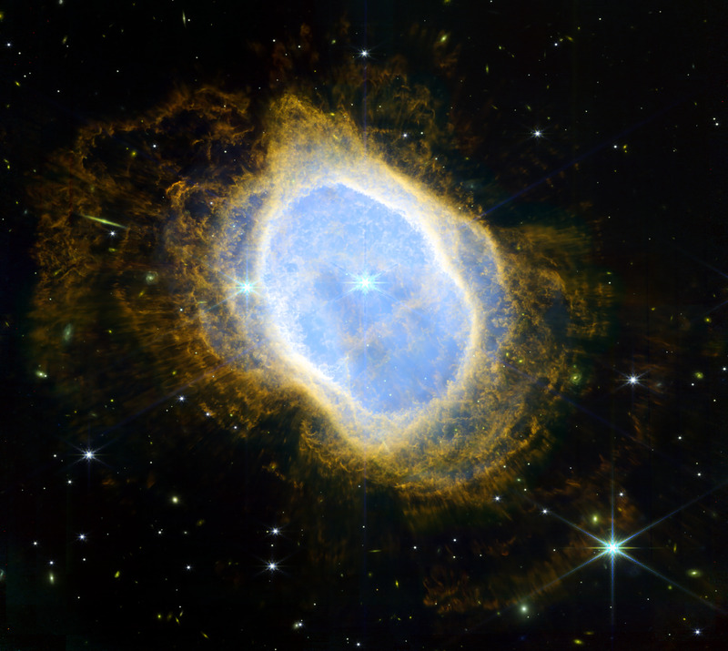
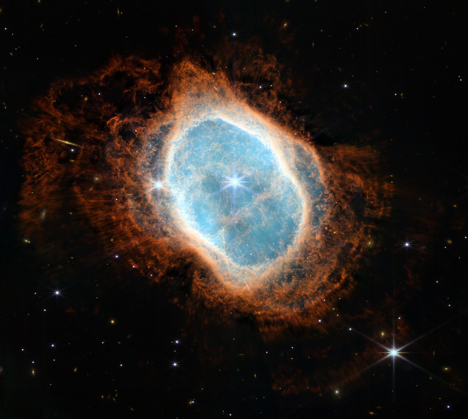
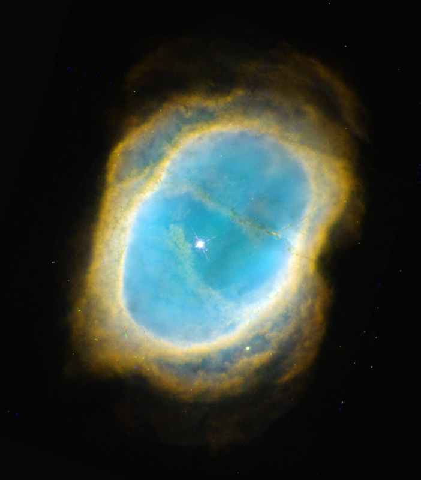
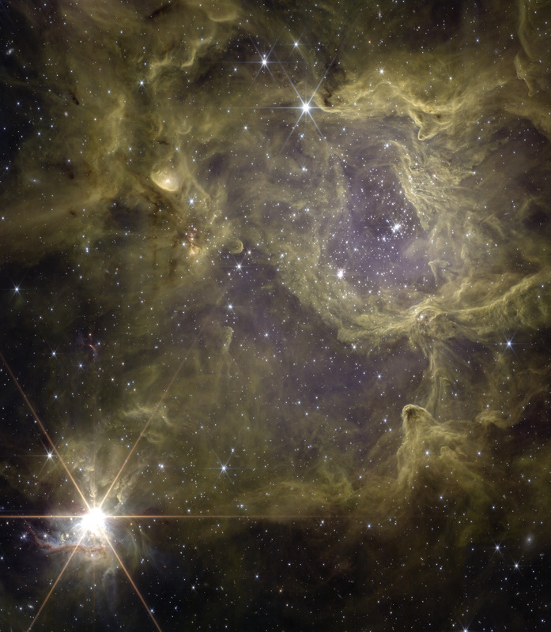
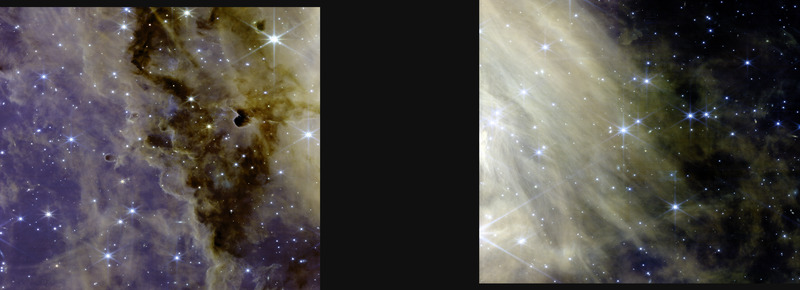
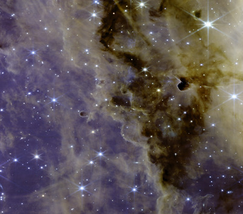
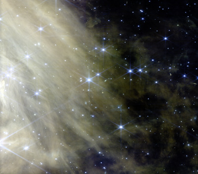

# Галерея конфигов Skyforge

Каждый раздел — принятый результат: превью, подпись, конфиг, тег и команда, которой получить тот же файл.
Файл создаёт `skyforge gallery` из `configs/publish.yaml`, принятых PNG (`data/baselines/`) и заголовков данных;
руками не правится. English: [GALLERY.md](GALLERY.md).

## NGC 3132 — JWST NIRCam, стиль measured



- **Программа:** 2733, руководитель — Pontoppidan, Klaus M.; наблюдения 2022-06-03; данные открыты 2022-07-13
- **Фильтры:** F090W 0,900 мкм — синий (#0000ff); F187N 1,87 мкм — бирюзовый (#00ffff); F212N 2,12 мкм — зелёный (#00ff00); F356W 3,56 мкм — жёлтый (#ffff00); F405N 4,05 мкм — красный (#ff0000); F470N 4,70 мкм — красный (#ff0000)
- **Указание источника:** NASA, ESA, CSA, STScI; обработка: Denis Krivosheev; лицензия на обработку — CC BY-SA 4.0
- **Конфиг:** [configs/ngc3132/measured.yaml](../configs/ngc3132/measured.yaml), тег [`phase-3k`](https://github.com/kriden187-cloud/skyforge/tree/phase-3k), принято 2026-10-20
- **Хеш пикселей итога (sha256):** `0f556d7667dbccca8ca49a82923d9bc79af94471caa7576f2c1fc1a49356f3b2`
- **Что показано:** Шесть фильтров NIRCam в порядке длины волны, вес F212N 0,25 (ореол H₂ настоящий).
- **Ограничения:** Ступеньки фона по границам числа экспозиций до ~0,6σ; ядра трёх насыщенных звёзд — белые пятна; лучи ярких звёзд вне маски звёзд.
- **Примечание:** Программа ERO 2733 (Early Release Observations); официальный снимок NIRCam — 12 июля 2022 (STScI 2022-033b, ESA/Webb weic2207b, «Southern Ring Nebula (NIRCam Image)»).
- **Как получить тот же файл:**

  ```
  git checkout phase-3k
  skyforge run ngc3132 -s measured --bin 1        # если данных нет на диске, скачает из MAST
  skyforge publish ngc3132 -s measured
  ```

## NGC 3132 — JWST NIRCam, стиль showcase



- **Программа:** 2733, руководитель — Pontoppidan, Klaus M.; наблюдения 2022-06-03; данные открыты 2022-07-13
- **Фильтры:** F090W 0,900 мкм — синий (#0000ff); F187N 1,87 мкм — бирюзовый (#00ffff); F212N 2,12 мкм — зелёный (#00ff00); F356W 3,56 мкм — оранжевый (#ff9a20); F405N 4,05 мкм — красный (#ff0000); F470N 4,70 мкм — красный (#ff0000)
- **Указание источника:** NASA, ESA, CSA, STScI; обработка: Denis Krivosheev; лицензия на обработку — CC BY-SA 4.0
- **Конфиг:** [configs/ngc3132/showcase.yaml](../configs/ngc3132/showcase.yaml), тег [`phase-3k`](https://github.com/kriden187-cloud/skyforge/tree/phase-3k), принято 2026-10-20
- **Хеш пикселей итога (sha256):** `2e72fc9c06d71b12f33fc5eea9fc9f8dc03233b59476679ead8d7236e87c053f`
- **Что показано:** Витрина в духе релиза NASA: пьедестал и носок неба, полином неба с гашением к туманности, подъём теней 2, насыщенность 1,2.
- **Ограничения:** Ступеньки по границам числа экспозиций; три детали фона видны при ×2–×5; внешний ореол слабее, чем у NASA; одна звезда поля с зеленоватым ядром.
- **Примечание:** Программа ERO 2733 (Early Release Observations); официальный снимок NIRCam — 12 июля 2022 (STScI 2022-033b, ESA/Webb weic2207b, «Southern Ring Nebula (NIRCam Image)»).
- **Опубликовано:** [Flickr](https://www.flickr.com/photos/205062605@N07/55603640956/) (2026-10-21)
- **Как получить тот же файл:**

  ```
  git checkout phase-3k
  skyforge run ngc3132 -s showcase --bin 1        # если данных нет на диске, скачает из MAST
  skyforge publish ngc3132 -s showcase
  ```

## NGC 3132 — HST WFPC2, стиль showcase



- **Программа:** 6221, руководитель — Trauger, John; наблюдения 1995-12-07; данные открыты 1996-12-08
- **Фильтры:** F502N 0,502 мкм — синий (#0000ff); F656N 0,656 мкм — зелёный (#00ff00); F658N 0,658 мкм — красный (#ff0000)
- **Указание источника:** NASA, ESA, STScI; обработка: Denis Krivosheev; лицензия на обработку — CC BY-SA 4.0
- **Конфиг:** [configs/ngc3132hst/showcase.yaml](../configs/ngc3132hst/showcase.yaml), тег [`phase-3b`](https://github.com/kriden187-cloud/skyforge/tree/phase-3b), принято 2026-10-20
- **Хеш пикселей итога (sha256):** `827ebc2ecbb4149c77133c62679fc60f6f51640d3d2376147645e0e2afa82b26`
- **Что показано:** WFPC2 1995 года, три узкополосных фильтра ([O III], Hα, [N II]), итог при bin 2.
- **Ограничения:** Bin 2 (bin 1 — передискретизация drizzle); 65 следов космических лучей на небе; 0,25% нулей в синем канале неба; швы ≤ 6 px заполнены линейно, углы — уровнем неба.
- **Примечание:** Те же данные WFPC2 легли в основу снимка Hubble Heritage 1998 года (STScI-1998-39).
- **Как получить тот же файл:**

  ```
  git checkout phase-3b
  skyforge run ngc3132hst -s showcase --bin 2        # если данных нет на диске, скачает из MAST
  skyforge publish ngc3132hst -s showcase
  ```

## Sh 2-305 — JWST NIRCam, стиль showcase



- **Программа:** 4547, руководитель — McCaughrean, Mark J.; наблюдения 2025-03-31; данные открыты 2026-04-02
- **Фильтры:** F182M 1,82 мкм — синий (#3050ff); F300M 3,00 мкм — голубой (#40c0ff); F335M 3,35 мкм — жёлто-зелёный (#c0ff40); F360M 3,60 мкм — оранжевый (#ff9020); F444W 4,44 мкм — красный (#ff2020)
- **Указание источника:** NASA, ESA, CSA, STScI; обработка: Denis Krivosheev; лицензия на обработку — CC BY-SA 4.0
- **Конфиг:** [configs/sh2305/showcase.yaml](../configs/sh2305/showcase.yaml), тег [`phase-4`](https://github.com/kriden187-cloud/skyforge/tree/phase-4), принято 2026-10-21
- **Хеш пикселей итога (sha256):** `439762383405fb558353f75843485ff6bc04ae64279ee0b53e3e390ba270fe50`
- **Что показано:** Пять фильтров NIRCam (F182M и четыре длинноволновых), палитра по длине волны с тёплым сдвигом, опорное небо по самым тёмным блокам, небо 16.
- **Ограничения:** Полосы 1/f F182M видны при ×5; ядро яркой звезды насыщено; F212N не вошёл (полосы 1/f на уровне 3); волокна PAH почти одного оттенка — фактура по яркости.
- **Примечание:** Данные открыты 2026-04-02. Известные более ранние обработки этих данных: Мелина Тевено (Wikimedia Commons, 2026-04-03); Томас Карпантье (Flickr, 2026-04-03); Исраэль Веласкес Родригес (Flickr, 2026-04-03); Андреа Лук (Flickr, 2026-04-11); Марк Маккохрейн, руководитель программы (Flickr, 2026-04-15, копия на Wikimedia Commons); Мехмет Хакан Озсарач (Flickr, 2026-05-18); Picturavis (Pixelfed, около 2026-05-22).
- **Опубликовано:** [Flickr](https://www.flickr.com/photos/205062605@N07/55603618036/) (2026-10-21)
- **Как получить тот же файл:**

  ```
  git checkout phase-4
  skyforge run sh2305 -s showcase --bin 1        # если данных нет на диске, скачает из MAST
  skyforge publish sh2305 -s showcase
  ```

## W3 — JWST NIRCam, стиль showcase



На площадках — двумя отдельными картинками: левая половина поля W3-JWST-2 — модуль A NIRCam · правая половина поля W3-JWST-2 — модуль B NIRCam:

 

- **Программа:** 5437, руководитель — Best, William; наблюдения 2024-10-29; данные открыты 2025-10-30
- **Фильтры:** F140M 1,40 мкм — фиолетово-синий (#6030ff); F182M 1,82 мкм — синий (#3050ff); F210M 2,10 мкм — голубой (#40c0ff); F300M 3,00 мкм — бирюзовый (#30ffb0); F335M 3,35 мкм — жёлто-зелёный (#c0ff40); F360M 3,60 мкм — жёлтый (#ffd820); F405N 4,05 мкм — оранжевый (#ff9020); F444W 4,44 мкм — красный (#ff2020)
- **Указание источника:** NASA, ESA, CSA, STScI; обработка: Denis Krivosheev; лицензия на обработку — CC BY-SA 4.0
- **Конфиг:** [configs/w3_2/showcase.yaml](../configs/w3_2/showcase.yaml), тег [`phase-6`](https://github.com/kriden187-cloud/skyforge/tree/phase-6), принято 2026-10-22
- **Хеш пикселей итога (sha256):** `6cfce60e995bc5fbef7e12c89d1e8c194c360cd3f1aa65e7d9c996e7007d8a11`
- **Что показано:** Восемь фильтров NIRCam (F140M, F182M, F210M и пять длинноволновых), два модуля с честным промежутком; палитра по длине волны с тёплым сдвигом; белая точка по туманности без звёзд в каждом фильтре; опорное небо по самым тёмным блокам; щели детекторов коротких фильтров заполнены соседним коротким фильтром.
- **Ограничения:** Пустого неба в поле нет: опора по слабейшей туманности, небо 18 вместо 16, абсолютный уровень условный; в полосах щелей коротких фильтров (13% площади модуля) цветовой шум ×1,7 — виден при ×3; около дюжины квадратов 4″ на пересечениях щелей (0,2% площади) заполнены F300M и отличаются по тону; пунктирные швы по краям полос — из исходных i2d; полосы 1/f коротких фильтров видны на небе при ×5.
- **Примечание:** Поле W3-JWST-2 программы 5437 (центр кадра RA 36,80°, Dec +62,00°) — в комплексе W3 между IC 1795 и W3(OH). Данные открыты 2025-10-30. Более ранних публичных цветных обработок этого поля не найдено (поиск 2026-10-21: поиск в сети, Wikimedia Commons, Flickr; Reddit, AstroBin и X не проверялись). Соседнее поле той же программы W3-JWST-1A обработал Thomas Carpentier (Flickr, 2025-10-13).
- **Как получить тот же файл:**

  ```
  git checkout phase-6
  skyforge run w3_2 -s showcase --bin 1        # если данных нет на диске, скачает из MAST
  skyforge publish w3_2 -s showcase
  ```
