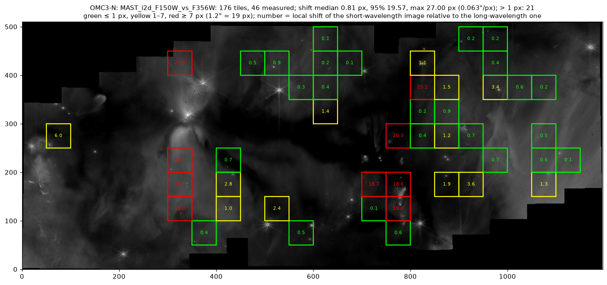
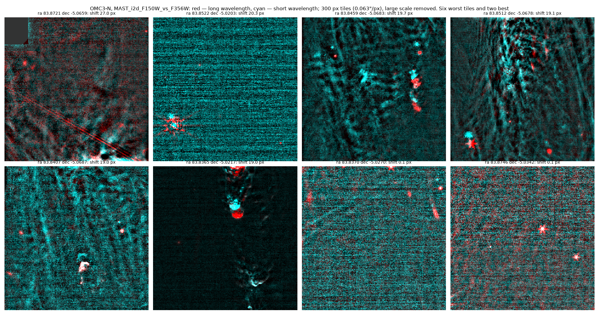
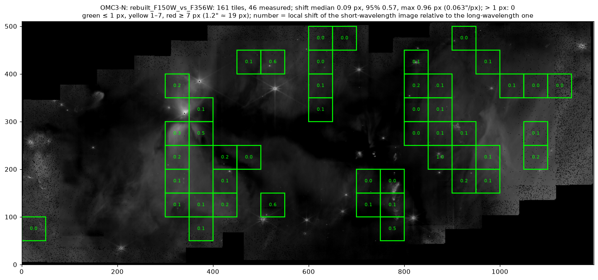

# Inter-visit astrometric offset in the MAST level-3 NIRCam mosaics of program 7433 (OMC3-N)

**To:** MAST / JWST Help Desk
**From:** Denis Krivosheev (independent image processing; pipeline: https://github.com/kriden187-cloud/skyforge)
**Date:** 2026-10-23

## Summary

The four level-3 NIRCam mosaics of JWST program 7433, observation 1 (OMC3-N), are built from two pairs of visits that were guided on different guide stars. The world coordinates of the visits guided on **S1LG092721** (visits 002 and 004) are displaced by **1.21″** relative to Gaia DR3 and relative to the visits guided on **S1LG003678** (visits 001 and 003). The i2d headers report `S_TWKREG = COMPLETE`, but the offset is not corrected in the mosaics. As a result:

- where only visits 002/004 cover the sky, all four mosaics are 1.2″ off in absolute astrometry;
- where visits overlap, stars and compact nebular features in the short- and long-wavelength mosaics are displaced by 1.2″ relative to each other (colour composites show doubled stars);
- in the overlap, outlier rejection appears to keep one visit or the other pixel by pixel, leaving patches of rejected pixels (`WHT = 0`) at bright compact features.

## Products

| product | CAL_VER | CRDS_CTX | DATE (processing) |
|---|---|---|---|
| jw07433-o001_t001_nircam_clear-f150w_i2d.fits | 3.0.0 | jwst_1584.pmap | 2026-10-15T01:56:19 |
| jw07433-o001_t001_nircam_clear-f200w_i2d.fits | 3.0.0 | jwst_1584.pmap | 2026-10-15T01:54:34 |
| jw07433-o001_t001_nircam_clear-f356w_i2d.fits | 3.0.0 | jwst_1584.pmap | 2026-10-15T01:40:03 |
| jw07433-o001_t001_nircam_clear-f480m_i2d.fits | 3.0.0 | jwst_1584.pmap | 2026-10-15T01:44:15 |

All four headers: `S_TWKREG = COMPLETE`, `S_OUTLIR = COMPLETE`, `S_SKYMAT = COMPLETE`, `S_RESAMP = COMPLETE`.

Visits (all on 2026-03-09; level-2 `_cal.fits` with CAL_VER 3.0.0, the same CRDS context):

| visit | filters (SW + LW, simultaneous) | guide star (GDSTARID) | start (UT) | offset vs Gaia DR3 |
|---|---|---|---|---|
| jw07433001001 | F200W + F480M | S1LG003678 | 10:52 | 0.03″ |
| jw07433001002 | F200W + F480M | S1LG092721 | 11:21 | **1.21″** |
| jw07433001003 | F150W + F356W | S1LG003678 | 11:54 | 0.02″ |
| jw07433001004 | F150W + F356W | S1LG092721 | 12:23 | **1.21″** |

The offset column is the shift that must be added to the `_cal` WCS positions to match Gaia DR3. Visit 002: ΔRA·cos δ = +1.183″, ΔDec = −0.266″. Visit 004: +1.185″, −0.265″. Visits 001 and 003: −0.022″/−0.015″ and −0.020″/−0.014″.

## Evidence

### 1. Level-2 exposures against Gaia DR3

Gaia DR3 sources within 6′ of the field centre were propagated to the observation epoch (2026.185) with their proper motions. Only 5-parameter solutions with RUWE ≤ 1.4 and a total position error ≤ 10 mas at the epoch were kept: 89 stars.

Most Gaia stars are saturated in NIRCam. Their centres were measured by point symmetry of the PSF wings around the saturated core. Unsaturated stars were measured with a 2-D Gaussian.

Detections in each `_cal` frame (raw WCS, including SIP) were differenced against Gaia and voted per visit for a coarse offset, then refined in the joint solution of section 4 (median over the three exposures of each visit):

| visit | offset ΔRA·cos δ / ΔDec (final) | coarse vote: peak / second-highest peak |
|---|---|---|
| 001 | −0.022″ / −0.015″ | no significant peak (offset is small) |
| 002 | +1.183″ / −0.266″ | 18 / 8 |
| 003 | −0.020″ / −0.014″ | 11 / 4 |
| 004 | +1.185″ / −0.265″ | 18 / 8 |

All exposures also share a common rotation of about −0.004° relative to Gaia. The two visits on S1LG092721 share the same offset to within 0.002″; the two visits on S1LG003678 agree with Gaia to 0.03″.

### 2. The i2d mosaics against Gaia DR3

The same Gaia stars were measured in the i2d mosaics. Each star was assigned to a zone by the footprints of the visits' detectors:

| filter | zone | Gaia stars | median (i2d − Gaia), E / N | median \|offset\| |
|---|---|---|---|---|
| F150W | only visits 001/003 (S1LG003678) | 2 | −0.015″ / +0.026″ | 0.030″ |
| F150W | only visits 002/004 (S1LG092721) | 3 | −1.185″ / +0.246″ | **1.210″** |
| F200W | only visits 001/003 | 2 | −0.012″ / +0.021″ | 0.024″ |
| F200W | only visits 002/004 | 3 | −1.182″ / +0.259″ | **1.210″** |
| F356W | only visits 001/003 | 2 | +0.025″ / +0.029″ | 0.039″ |
| F356W | only visits 002/004 | 3 | −1.187″ / +0.253″ | **1.213″** |
| F356W | overlap | 1 | −1.011″ / +0.185″ | 1.028″ |
| F480M | only visits 001/003 | 2 | +0.014″ / −0.033″ | 0.040″ |
| F480M | only visits 002/004 | 2 | (inconsistent pair) | 0.315″ |

The offset of the S1LG092721 zone in the i2d is the negative of the correction measured on the level-2 exposures. In other words, the i2d keeps the original WCS of visits 002/004. The field is a dark cloud, so few Gaia stars are usable per zone, but three filters give the same vector to 0.01″.

### 3. Internal consistency of the mosaics

The F150W i2d was compared with the F356W i2d tile by tile: 300-pixel tiles at 0.063″/px, the F150W mosaic reprojected onto the F356W grid, large scales removed, peak of the cross-correlation. Of 46 tiles with enough structure, 21 are displaced by more than 1 px, and the 95th percentile is 19.6 px (1.2″). The displaced tiles lie where visits 003 and 004 overlap.

**Figure 1.** Local shift of F150W relative to F356W in the MAST mosaics; detector footprints of both visits.

**Figure 2.** F356W (red) and F150W (cyan) in the six worst tiles and two good ones. The same stars and the knot of an outflow (ra 83.8365, dec −5.0217) appear twice, 1.2″ apart.

### 4. A rebuild from the level-2 data removes the offset

A mosaic rebuilt from the same `_cal` files fixes the doubling. Each exposure (all SW and LW detectors together) received one correction: a shift plus a small rotation. The corrections come from one least-squares solution over two kinds of constraints: 6,407 pairs of the same star in different exposures, and 57 matches to Gaia DR3. The relative precision between exposures is ≤ 0.020 SW px (0.6 mas); the absolute tie to Gaia is 0.026–0.038 SW px. After the correction, star pairs between visits 003 and 004 agree to 0.051 ± 0.015 SW px. The mean Gaia residuals of the two visits differ by 0.30 ± 0.10 SW px (9 ± 3 mas, 11 and 18 stars); this is within what Gaia position errors at the epoch allow and does not show in the star pairs.

In the rebuilt mosaics the same Gaia stars lie within 0.007–0.017″ of their catalogue positions in every zone and filter (these stars were part of the fit, so this is not an independent test). Independent of Gaia, the tile cross-correlation of the rebuilt F150W against F356W gives a median shift of 0.09 px, 95% of tiles within 0.57 px and a maximum of 0.96 px (0.063″/px), against 19.6 px for the 95th percentile in the MAST mosaics. The patches of rejected pixels at the bright features near the protostar (ra 83.858, dec −5.068) are absent in the rebuild: the pixels there are valid in every exposure.

**Figure 3.** The same tile test on the rebuilt mosaics.

## How to reproduce

1. Download the `_cal.fits` files of observation 1 (visits 001–004) and the four i2d products from MAST.
2. Query Gaia DR3 within 6′ of RA 83.85167, Dec −5.03889 and propagate the positions to the epoch 2026.185.
3. In any SW detector of visit 004 that sees a Gaia star, the star is found about 1.2″ from its Gaia position under the raw WCS; under the same procedure, visit 003 agrees to about 0.03″. Detector example: `jw07433001004_03101_00002_nrcb4_cal.fits` (3 Gaia stars, median offset +15.3 / −37.2 px in detector coordinates).
4. In the i2d, measure a Gaia star in the region covered only by visits 002/004. For F150W the offset is −1.185″ E / +0.246″ N.

The scripts used for this report are in the public repository https://github.com/kriden187-cloud/skyforge:

- `scripts/i2d_offset_check.py` — i2d against Gaia by zone;
- `scripts/registration_check.py` — tile shifts and overlays (figures 1–3);
- `src/skyforge/astrometry.py` — per-exposure solution against Gaia DR3.

## Possible cause

The two visit pairs were guided on different guide stars, and the guide-star position error appears to have entered the WCS of visits 002/004. tweakreg reports COMPLETE, but its alignment was evidently not applied, or it fell back to no correction. Few unsaturated point sources exist in this dark-cloud field, so the step may have failed silently.
